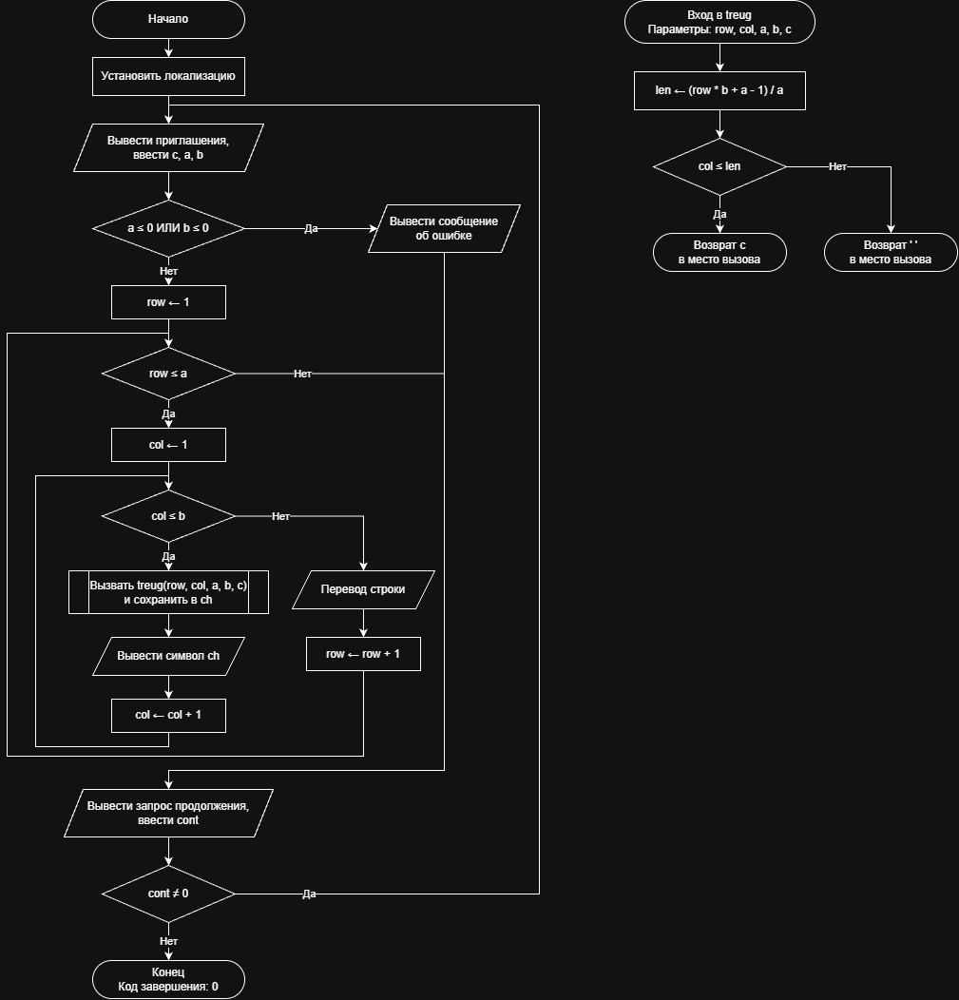

# Домашнее задание к работе 9

## Условие задачи
Написать программу, выводящую на экран заданную
геометрическую фигуру, нарисованную с помощью заданного с клавиатуры
символа, условие заполнения фигуры и задаваемые параметры фигуры в
таблице (остальные можно взять константные)
(https://drive.google.com/file/d/1NpTIvrBy8P8JVqpB-33r0osT3zzilhWT/view)

## 1. Алгоритм и блок-схема

### Алгоритм
1. **Начало**.
2. Инициализация окружения: установка локализации UTF-8 для корректного вывода символов.
3. Цикл с постусловием (do-while):
   - Ввести с клавиатуры символ построения фигуры c, высоту a и ширину основания b.
   - Проверить корректность размеров: если a <= 0 или b <= 0, вывести сообщение об ошибке.
   - Иначе выполнить печать фигуры с помощью вложенных циклов:
     - Инициализировать номер строки row = 1.
     - Пока row <= a (внешний цикл):
       - Инициализировать номер столбца col = 1.
       - Пока col <= b (внутренний цикл):
         - Вызвать функцию treug(row, col, a, b, c), сохранить символ в переменную ch и вывести ch на экран.
         - Увеличить счетчик столбцов: col = col + 1.
       - Перевести курсор на новую строку и увеличить счетчик строк: row = row + 1.
   - Запросить у пользователя код продолжения работы cont (0 — выход, любое другое число — продолжить).
4. Проверка условия цикла: если cont != 0, повторить шаг 3.
5. **Конец**.

**Часть 2: Расчетная функция символа фигуры (treug)**
1. **Начало функции**: получение параметров row, col, a, b, c.
2. Вычислить ширину заполнения текущей строки: $len = (row \cdot b + a - 1) / a$.
3. Проверить попадание текущей позиции в контур треугольника:
   - Если col <= len, вернуть символ c в вызывающую функцию (main).
   - Иначе вернуть символ пробела `' '` в вызывающую функцию (main).
4. **Конец**.

### Блок-схема
 

https://github.com/stzraw/lab-9-VSTU-HW/blob/main/pravki9.drawio.png

## 2. Реализация программы

```c
#include <stdio.h>
#include <locale.h>

char treug(int row, int col, int a, int b, char c);

int main()
{
    int a, b, row, col, cont;
    char c, ch;

    setlocale(LC_ALL, ".UTF8");

    do
    {
        printf("Введите символ из которого будет строиться фигура: ");
        scanf(" %c", &c);
        printf("Введите высоту a: ");
        scanf("%d", &a);
        printf("Введите ширину b: ");
        scanf("%d", &b);

        if (a <= 0 || b <= 0)
        {
            printf("Ошибка: размеры должны быть положительными\n");
        }
        else
        {
            printf("Прямоугольный треугольник:\n\n");
            for (row = 1; row <= a; row++)
            {
                for (col = 1; col <= b; col++)
                {
                    ch = treug(row, col, a, b, c);
                    putchar(ch);
                }
                putchar('\n');
            }
        }

        printf("\nПродолжить? (Да - введите любое число, Нет - введите 0): ");
        scanf("%d", &cont);
    } while (cont != 0);
    return 0;
}

char treug(int row, int col, int a, int b, char c)
{
    int len;

    len = (row * b + a - 1) / a;
    if (col <= len)
    {
        return c;
    }
    else
    {
        return ' ';
    }
}
```

## 3. Результаты работы программы

Введите символ из которого будет строиться фигура: *
Введите высоту a: 5
Введите ширину b: 10
Прямоугольный треугольник:

```
**
****
******
********
**********
```

## 4. Информация о разработчике

Быханов Александр Андреевич бИД - 262 2пг

