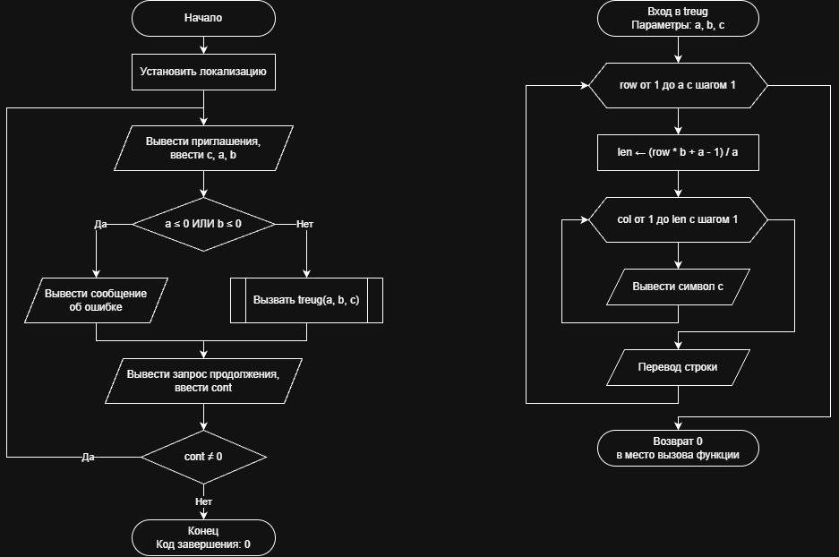

# Домашнее задание к работе 9

## Условие задачи
Написать программу, выводящую на экран заданную
геометрическую фигуру, нарисованную с помощью заданного с клавиатуры
символа, условие заполнения фигуры и задаваемые параметры фигуры в
таблице (остальные можно взять константные)
(https://drive.google.com/file/d/1NpTIvrBy8P8JVqpB-33r0osT3zzilhWT/view)

## 1. Алгоритм и блок-схема

### Алгоритм
1. **Начало**.
2. Инициализация окружения: установка локализации UTF-8 для корректного вывода символов.
3. Цикл с постусловием (do-while):
   - Ввести с клавиатуры символ построения фигуры c.
   - Ввести высоту прямоугольного треугольника a и ширину основания b.
   - Проверить корректность размеров: если a <= 0 или b <= 0, вывести сообщение об ошибке «Ошибка: размеры должны быть положительными».
   - Иначе вызвать функцию treug(a, b, c) для печати прямоугольного треугольника.
   - Запросить у пользователя код продолжения работы cont (0 — выход, любое другое число — продолжить).
4. Проверка условия цикла: если cont != 0, повторить шаг 3.
5. **Конец**.

**Часть 2: Функция печати фигуры (treug)**
1. **Начало функции**: получение параметров a, b, c.
2. Внешний цикл с параметром (для row от 1 до a включительно с шагом 1):
   - Вычислить количество символов в текущей строке: $len = (row \cdot b + a - 1) / a$.
   - Внутренний цикл с параметром (для col от 1 до len включительно с шагом 1):
     - Вывести символ c на экран с помощью функции putchar(c).
   - Перевести курсор на новую строку с помощью putchar('\n').
3. Возврат значения: вернуть 0 обратно в вызывающую функцию (main) и завершить работу.
4. **Конец**.

### Блок-схема
 

https://github.com/stzraw/lab-9-VSTU-HW/blob/main/lab_9_schema.png

## 2. Реализация программы

```c
#include <stdio.h>
#include <locale.h>

int treug(int a, int b, char c);

int main()
{
    int a, b, cont;
    char c;

    setlocale(LC_ALL, ".UTF8");

    do
    {
        printf("Введите символ из которого будет строиться фигура: ");
        scanf(" %c", &c);
        printf("Введите высоту a: ");
        scanf("%d", &a);
        printf("Введите ширину b: ");
        scanf("%d", &b);

        if (a <= 0 || b <= 0)
        {
            printf("Ошибка: размеры должны быть положительными\n");
        }
        else
        {
            printf("Прямоугольный треугольник:\n\n");
            treug(a, b, c);
        }

        printf("\nПродолжить? (Да - введите любое число, Нет - введите 0): ");
        scanf("%d", &cont);
    } while (cont != 0);
    return 0;
}

int treug(int a, int b, char c)
{
    int row, col, len;

    for (row = 1; row <= a; row++)
    {
        len = (row * b + a - 1) / a;
        for (col = 1; col <= len; col++)
        {
            putchar(c);
        }
        putchar('\n');
    }
    return 0;
}
```

## 3. Результаты работы программы

Введите символ из которого будет строиться фигура: *
Введите высоту a: 5
Введите ширину b: 10
Прямоугольный треугольник:

```
**
****
******
********
**********
```

## 4. Информация о разработчике

Быханов Александр Андреевич бИД - 262 2пг

